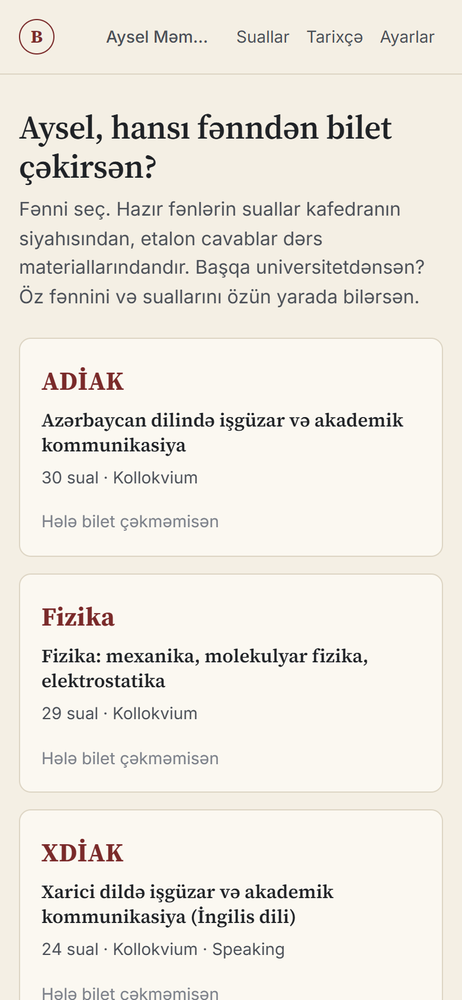
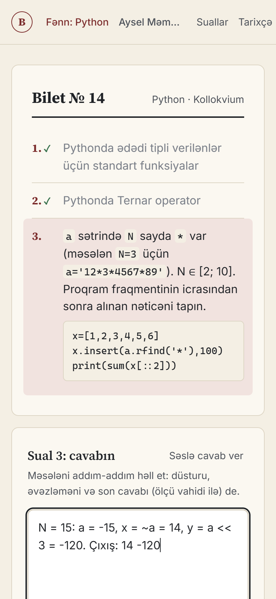
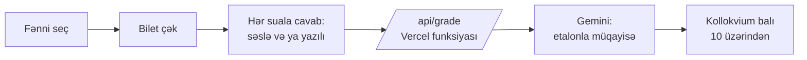

<div align="center">


# Bilet Çək

**Kollokvium və imtahan biletini çək, cavab ver, süni intellektdən 10 ballıq qiymət al.**

[](https://bilet-cek.vercel.app)
[](https://vercel.com)
[](https://aistudio.google.com)

**[Saytı aç →](https://bilet-cek.vercel.app)**

</div>

---

Universitetdə kollokvium günü sual siyahısından bilet çəkilir və cavab verilir. Bu sayt həmin anı evdə sınamaq üçündür: fənni seçirsən, real biletdəki kimi suallar düşür, cavabını **səslə və ya yazılı** verirsən, sonra süni intellekt cavabı etalonla müqayisə edib qiymət və ətraflı rəy verir.

**Hər kəs öz fənnini əlavə edə bilər.** Sual PDF-ni, Word faylını və ya mətnini yüklə: sistem ondan sualları çıxarıb sənin üçün ayrıca sınaq yaradır. Fayl serverə göndərilmir, yalnız sənin brauzerində qalır.

## Necə işləyir

<table>
<tr>
<td width="25%" align="center"><br><b>1. Fənni seç</b><br><sub>Hazır fənlər və ya öz yaratdığın sınaq.</sub></td>
<td width="25%" align="center"><br><b>2. Bilet çək</b><br><sub>Masada 10 bilet var, birini götürürsən.</sub></td>
<td width="25%" align="center"><br><b>3. Cavab ver</b><br><sub>Hər suala ayrıca, səslə və ya yazılı. Kod tapşırıqları kod bloku ilə göstərilir.</sub></td>
<td width="25%" align="center"><br><b>4. Bal al</b><br><sub>Kollokvium balı 10 üzərindən, hər sual üçün rəy və çatışmayanlar.</sub></td>
</tr>
</table>



## Fənlər

| Fənn | Sual növü | Cavab forması | Qiymətləndirmə |
|---|---|---|---|
| **ADİAK** | 30 nəzəri sual (hər onluqdan 1) | səslə (yazılı da olar) | etalon cavabla müqayisə |
| **Fizika** | 19 nəzəri sual + 10 məsələ | yazılı (səslə də olar) | nəzəriyyədə etalonla, məsələdə düzgün həll və cavabla |
| **XDİAK** (ingilis dili) | 25 speaking mövzusu | səslə (yazılı da olar) | qrupun **səviyyəsinə** görə: Elementary-dən Upper-Intermediate-ə; leksik və qrammatik səhvlər sayılır, səviyyədən yuxarı söz tələb olunmur |
| **Proqramlaşdırma** (Python) | 20 nəzəri mövzu + 10 kod izləmə tapşırığı | yazılı | nəzəriyyədə etalonla, tapşırıqda çıxışın düzgünlüyü ilə |
| **Riyazi analiz** | 10 nəzəri sual + 20 çalışma | yazılı | nəzəriyyədə etalonla, çalışmada həll və cavabla |

Yeni hazır fənn əlavə etmək `build_subjects.py`-də bir funksiya yazmaq deməkdir.

## Öz sınağını yarat (başqa universitet, başqa fənn)

Fənn seçimi ekranında **"Öz sınağını yarat"**: PDF, Word (.docx), .txt faylı yüklə və ya mətni yapışdır. Fayl **brauzerdə** oxunur. Sonra:

- **Sualları tap:** süni intellekt sənədin içindən sualları çıxarır (başlıq, təlimat, səhifə nömrəsi atılır; fayldakı cavablar varsa götürülür).
- **Hər sətir bir sual:** süni intellektsiz, sürətli yol.
- **Materialdan sual yarat:** yalnız dərs mətnin varsa, ondan sual və etalon cavab yazılır.
- **Etalon cavabları materialdan yarat:** cavabsız suallar üçün, yalnız sənin materialına əsaslanaraq (materialda olmayan "(Materialda yoxdur)" kimi işarələnir).
- Siyahını redaktə et, bilet ölçüsünü (1–10 sual), maksimum balı (10–100), cavab dilini (az, en, ru, tr) və növü (nəzəri / məsələ / ingilis speaking) seç.

Etalon cavab məcburi deyil: olmasa, süni intellekt öz fənn biliyinə görə yoxlayır. Fənlər **yalnız sənin brauzerində** saxlanılır (serverdə heç nə yoxdur); **Paylaş** düyməsi `.json` faylı verir, dostun "Dostun fənnini yüklə" ilə açır. Yüklənən fayllar təmizlənir (yalnız mətn, uzunluq limitləri).

## Xüsusiyyətlər

- **Real imtahan hissi:** bilet çəkmə, hazırlıq vaxtı, hər suala vaxt limiti.
- **Səs → mətn → qiymət bir addımda:** Gemini həm danışığı mətnə çevirir, həm qiymətləndirir. Brauzerin nitq tanıması işlədilmir (iPhone Safari Azərbaycan dilini tanımır).
- **Sual növünə uyğun qiymətləndirmə:** nəzəri sual, məsələ və ya kod tapşırığı (həll yolu və son cavab) və ingilis dilində danışıq (task, qrammatika, lüğət, axıcılıq) üçün ayrı meyarlar.
- **Kollokvium 10 baldır:** hər sual 0–10 keyfiyyət qiyməti alır (Təhsil Nazirliyinin 1060 saylı əsasnaməsindəki meyarlara uyğun), biletin balı bu ortalamadır. Fənn üzrə dəyişmək üçün `max` sahəsi var.
- **Ətraflı rəy:** düzgün fikirlər, çatışmayanlar (ingilis dilində: səhvlər və düzəlişlər), nitq qeydi.
- **Profillər, tarixçə, zəif suallar:** nəticələr fənnə görə ayrı saxlanır; "zəif suallara üstünlük" rejimi.
- **Telefon və kompüter:** mobil üçün yazılıb, masaüstündə də rahat işləyir.

<details>
<summary><b>Masaüstü görünüşü</b></summary>
<br>

</details>

## Məxfilik və arxitektura

- Nəticələr, profillər və öz fənlərin yalnız **sənin brauzerində** (localStorage) saxlanır. Serverdə verilənlər bazası yoxdur.
- Hər istifadəçi **öz pulsuz Gemini açarını** işlədir. Açar brauzerdə saxlanır və yalnız qiymətləndirmə sorğusu ilə bu saytın serverinə göndərilir, kodda açar yoxdur.
- `/api/grade` funksiyası etalon cavabı və promptu serverdə qurur, ona görə hazır fənlərin etalon cavabı qiymətləndirmə zamanı brauzerə ötürülmür.
- Gemini limiti dolsa, server avtomatik ehtiyat modelə keçir.

## Texnologiyalar

Build addımı yoxdur: sadə **HTML + CSS + JavaScript** (framework yoxdur), **Vercel Functions** (Node 20+), **MediaRecorder / Web Audio API**, **Gemini API** (strukturlu JSON cavab). Dizayn: mat kağız tonları, bordo vurğu, parıltı və neon effekt yoxdur.

## Fayllar

```
index.html, style.css, app.js     sayt
api/grade.js                      Vercel funksiyası: sual növünə görə prompt, Gemini sorğusu
build_subjects.py                 mənbə fayllardan (docx, md, pdf) subjects.js və api/_data.js yaradır
subjects.example.js               fənn məlumatının nümunəsi
api/_data.example.js              eyni məlumat, server üçün
docs/                             README şəkilləri
```

> Real etalon cavablar (`subjects.js`, `api/_data.js`, `answers/`) dərs materiallarına əsaslandığı üçün bu repo-da yoxdur. Nümunə fayllarla sayt işləyir, cavabları öz materialına görə doldurmaq lazımdır.

## Özün işə salmaq

1. `cp subjects.example.js subjects.js` və `cp api/_data.example.js api/_data.js`, ya da `python build_subjects.py` (öz mənbə fayllarınla).
2. Yerli: `npx vercel dev`. Yerləşdirmə: `npx vercel --prod`. Mikrofon yalnız HTTPS-də işləyir.
