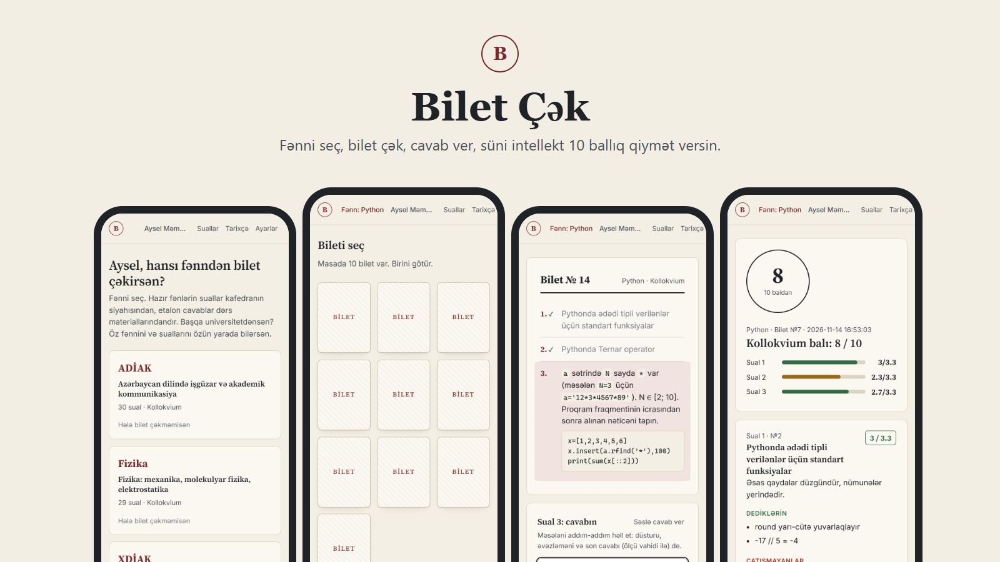
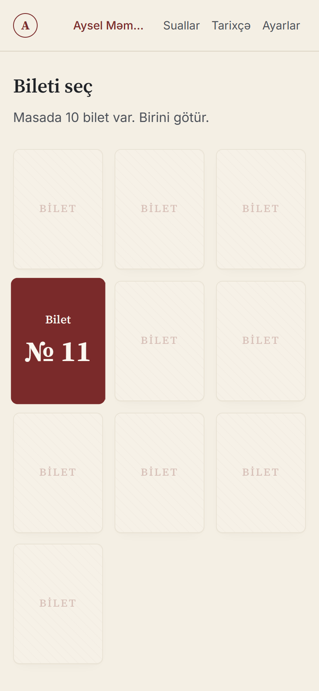
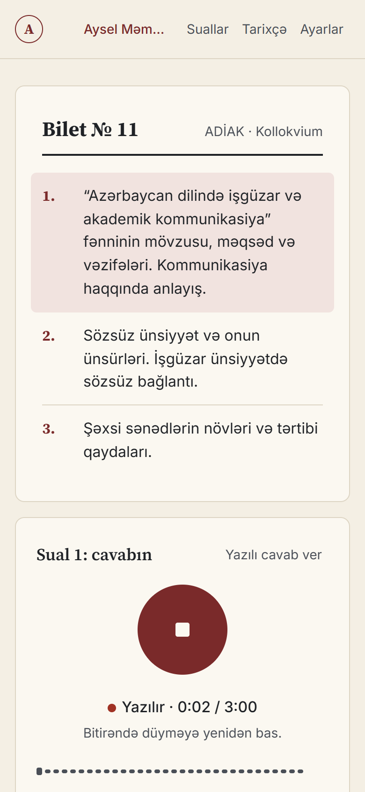
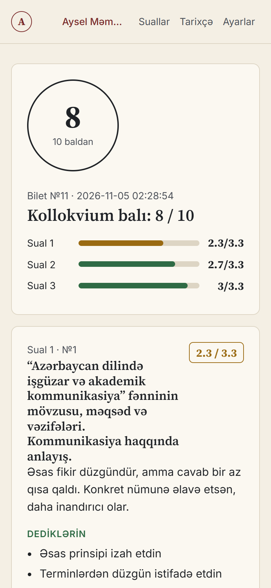
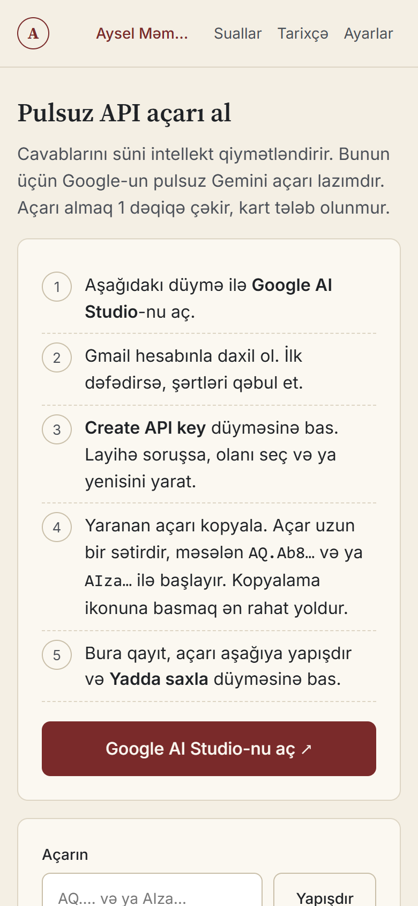
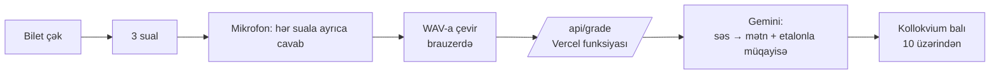
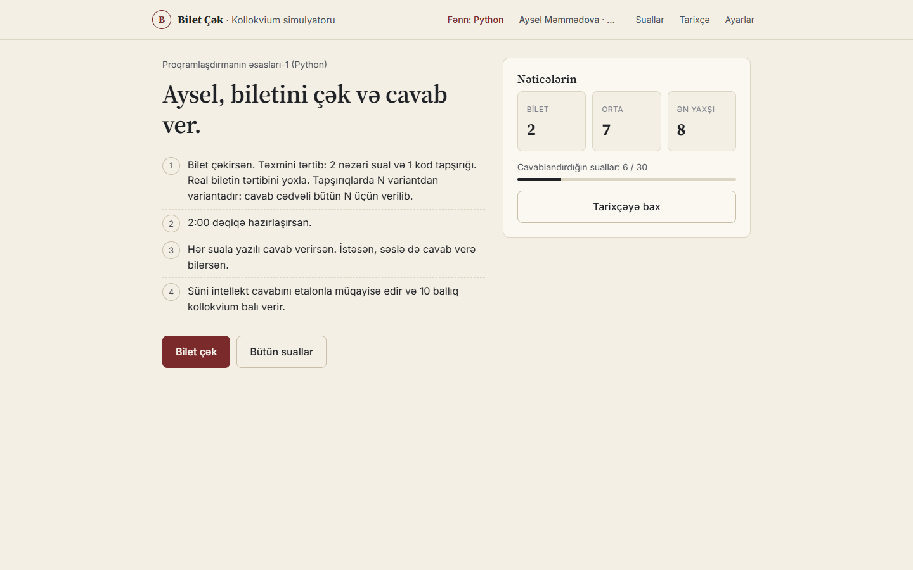

<div align="center">



# ADİAK Bilet

**Kollokvium biletini çək, 3 suala səsli cavab ver, 10 ballıq qiymət al.**

[](https://adiak-bilet.vercel.app)
[](https://vercel.com)
[](https://aistudio.google.com)

**[Saytı aç →](https://adiak-bilet.vercel.app)**

</div>

---

AzTU-da "Azərbaycan dilində işgüzar və akademik kommunikasiya" (ADİAK) fənni üzrə kollokvium şifahi keçirilir: 30 suallıq siyahıdan bilet çəkilir, düşən üç suala tələbə şifahi cavab verir. Bu sayt həmin imtahanı evdə sınamaq üçündür. Real bilet çəkirsən, hər suala **səslə** cavab verirsən, sonda süni intellekt cavabını dərs materialı ilə müqayisə edib **10 ballıq kollokvium balı** verir.

## Necə işləyir

<table>
<tr>
<td width="25%" align="center"><br><b>1. Bilet çək</b><br><sub>10 bilet masadadır, birini götürürsən. 30 sualdan 3-ü düşür.</sub></td>
<td width="25%" align="center"><br><b>2. Danış</b><br><sub>Hər suala ayrıca, mikrofonla cavab verirsən. İstəsən yazılı da olar.</sub></td>
<td width="25%" align="center"><br><b>3. Bal al</b><br><sub>Kollokvium balı 10 üzərindən, hər sual üçün rəy və çatışmayan fikirlər.</sub></td>
<td width="25%" align="center"><br><b>4. Öz açarın</b><br><sub>Pulsuz Gemini açarını addım-addım izahla bir dəqiqəyə alırsan.</sub></td>
</tr>
</table>



## Xüsusiyyətlər

- **Real imtahan hissi:** bilet çəkmə animasiyası, hazırlıq vaxtı (0–10 dəq), hər suala danışma limiti (2–4 dəq).
- **Səsli cavab:** brauzerdə yazılır və WAV-a çevrilir. Fayl Vercel-in 4.5 MB limitinə sığsın deyə tezlik (8–16 kHz) cavabın uzunluğuna görə seçilir.
- **Səs → mətn → qiymət bir addımda:** Gemini həm danışığı Azərbaycan dilində mətnə çevirir, həm də etalon cavabla müqayisə edir. Brauzerin öz nitq tanıması (Web Speech API) istifadə olunmur, çünki iPhone Safari Azərbaycan dilini tanımır.
- **10 ballıq sistem:** kollokvium cəmi 10 baldır. Hər sual 0–10 keyfiyyət balı alır, 3 sualın ortalaması kollokvium balı olur (hər sualın payı 3.3).
- **Ətraflı rəy:** düzgün dediyin fikirlər, çatışmayanlar, qısa rəy və nitq mədəniyyəti haqqında qeyd. Transkriptə və etalon cavaba baxa bilərsən.
- **Profillər:** eyni cihazdan bir neçə nəfər işlədə bilər, nəticələr ada görə ayrı saxlanır.
- **Tarixçə və zəif suallar:** hər sualın son balı yadda qalır. "Zəif suallara üstünlük" rejimi aşağı bal aldığın və hələ cavablamadığın sualları tez-tez çıxarır.
- **Sual bankı:** 30 sual və etalon cavablar axtarışla oxunur.
- **Telefon və kompüter:** mobil üçün yazılıb, mikrofon iPhone Safari və Chrome-da işləyir.

<details>
<summary><b>Masaüstü görünüşü</b></summary>
<br>

</details>

## Məxfilik və arxitektura

- Nəticələr və profillər yalnız **sənin brauzerində** (localStorage) saxlanır. Serverdə verilənlər bazası yoxdur.
- Hər istifadəçi **öz pulsuz Gemini açarını** işlədir. Açar brauzerdə saxlanır və yalnız qiymətləndirmə sorğusu ilə bu saytın serverinə göndərilir, kodda açar yoxdur.
- `/api/grade` funksiyası etalon cavabı və promptu serverdə qurur, ona görə etalon cavab qiymətləndirmə zamanı brauzerə ötürülmür. İstəsən, Vercel-də `GEMINI_API_KEY` mühit dəyişəni qoyub ümumi açar da verə bilərsən.
- Gemini limiti dolsa, server avtomatik ehtiyat modelə keçir (`gemini-3.5-flash-lite` → `gemini-3.1-flash-lite`).

## Texnologiyalar

Build addımı yoxdur: sadə **HTML + CSS + JavaScript** (framework yoxdur), **Vercel Functions** (Node 20+), **MediaRecorder / Web Audio API**, **Gemini API** (strukturlu JSON cavab).
Dizayn: mat kağız tonları, bordo vurğu, Source Serif 4 + Inter, parıltı və neon effekt yoxdur.

## Fayllar

```
index.html, style.css, app.js     sayt (build lazım deyil)
api/grade.js                      Vercel funksiyası: prompt, Gemini sorğusu, ehtiyat model
questions.example.js              30 rəsmi sual, etalon cavab yerində nümunə mətn
api/_data.example.js              eyni məlumat, server üçün
build_questions.py                sual docx-ini və cavab .md faylını oxuyub yuxarıdakıları yaradır
docs/                             README şəkilləri
```

> **Qeyd:** real etalon cavablar (`questions.js`, `api/_data.js`) dərs vəsaitinə əsaslandığı üçün bu repo-da yoxdur. Nümunə fayllarla sayt işləyir, cavabları öz materialına görə doldurmaq lazımdır.

## Özün işə salmaq

1. Nümunə faylları köçür və cavabları öz materialına görə yaz:
   ```bash
   cp questions.example.js questions.js
   cp api/_data.example.js api/_data.js
   ```
2. Yerli işə salma (funksiya ilə birlikdə): `npx vercel dev`.
3. Yerləşdirmə: `npx vercel --prod`. Mikrofon yalnız HTTPS-də işləyir, Vercel ünvanı bunu təmin edir.
